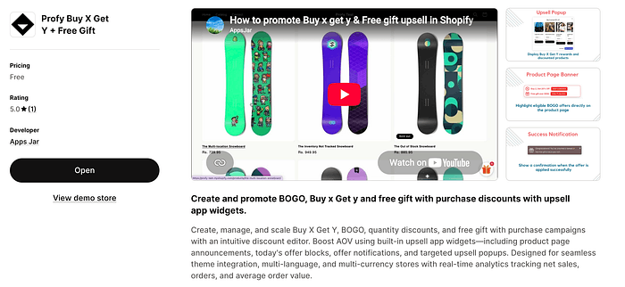
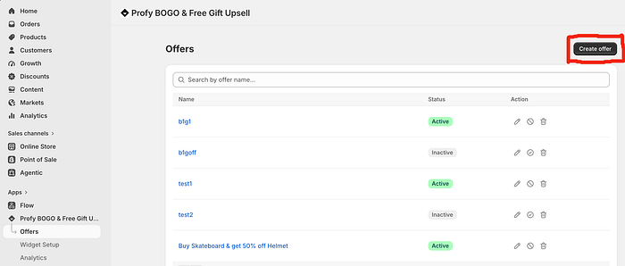
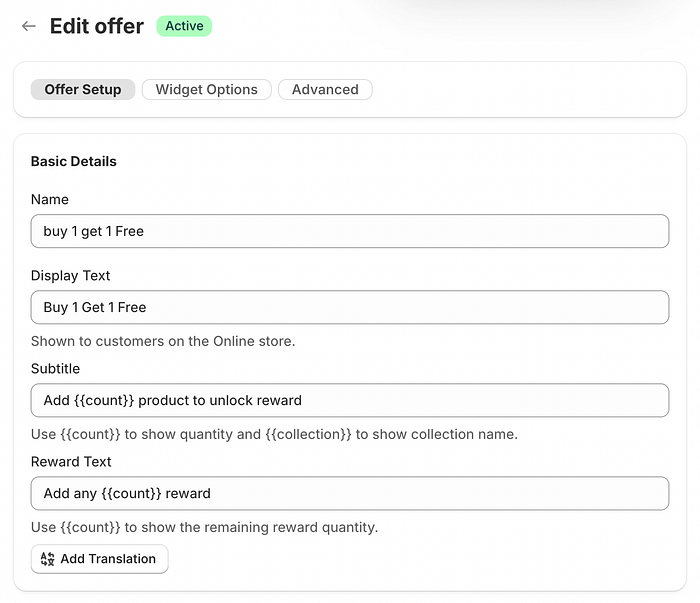
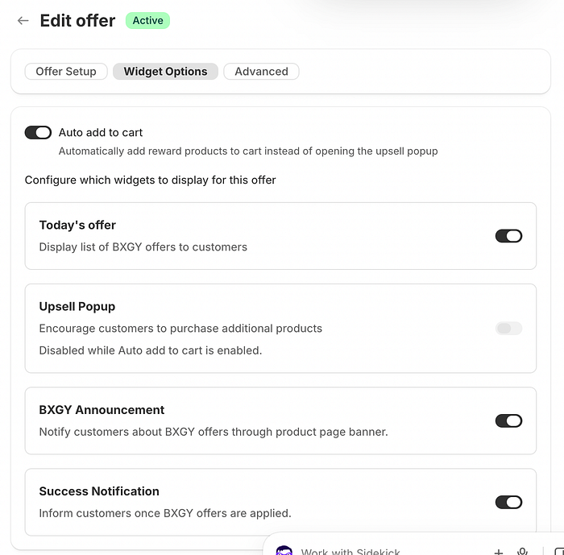
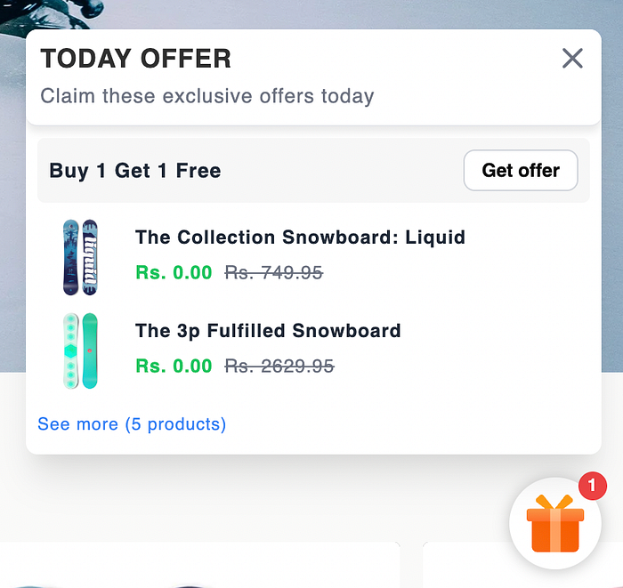
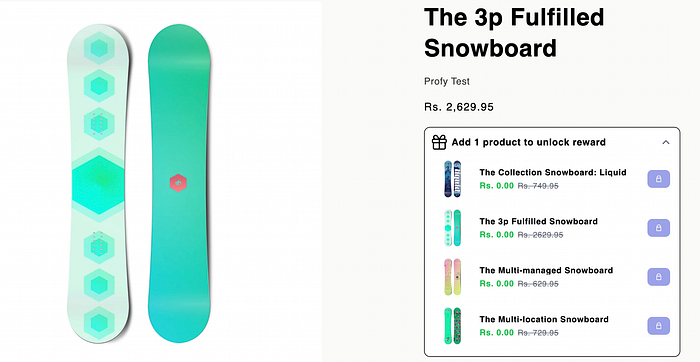
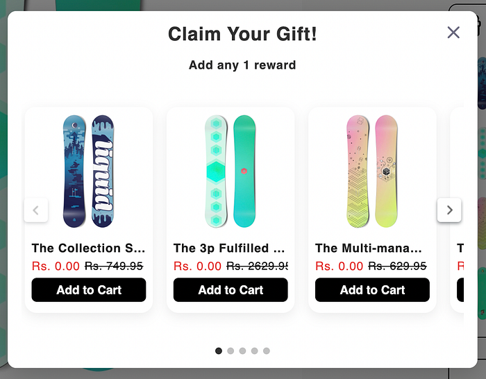
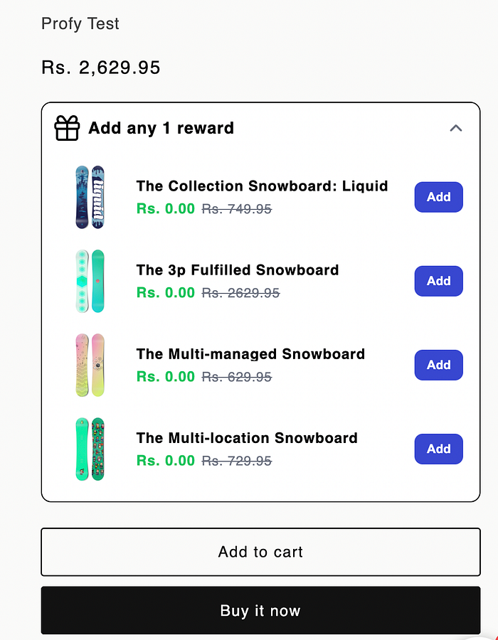
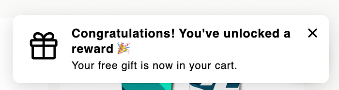

In Shopify, free gifts are offered through **Buy X Get Y Free discounts**, where customers receive a free product (Get Y) as a reward for meeting a purchase condition (Buy X). For example, customers get a free gift when they purchase a specific product or meet a minimum quantity requirement.

There are different types of free gift offers, such as **Buy 1 Get 1 Free** and **Buy 2 Get 1 Free**. You can read our dedicated articles to learn how to create and promote each type of offer.

In this article, you’ll learn how to set up a “ **Buy X, Get Y Free**” discount, effectively promote the offer, and seamlessly guide customers to claim their free gift once the conditions are met.

### When to Offer a Free Gift

Free gift offers can help your Shopify store achieve several business goals:

1. **Increase Average Order Value:** Encourage customers to purchase more items in a single order to qualify for a free gift.
2. **Clear Excess Inventory:** Offer slow-moving products as free gifts to help clear excess stock.
3. **Promote New Products:** Let customers try new products as free gifts, building awareness and encouraging future purchases.
4. **Encourage Bulk Purchases:** Offers like Buy 2 Shirts Get 1 Free make bulk purchases more attractive and encourage customers to buy larger quantities.

### Limitations of Offering Free Gifts Natively in Shopify

You can offer free gifts on Shopify by creating a **Buy X Get Y discount**. Follow Shopify’s [official guide](https://help.shopify.com/en/manual/discounts/discount-types/buy-x-get-y) to set up the discount.

However, Shopify’s default discount functionality has some limitations. While you can create the discount, there is **no built-in way to effectively promote the offer** to customers or encourage them to add the free gift to their cart once the purchase conditions are met.

As a result, **customers may not even know the offer exists** or understand how to claim their free gift, making it difficult to get the most out of your promotion.

### Installing a Shopify App for Free Gifts

<figure>
  
  <figcaption>Profy app page</figcaption>
</figure>

To overcome the limitations of Shopify’s default discount functionality, we’ll use the [**Buy X Get Y + Auto Add Free Gift**](https://apps.shopify.com/profy-bogo-free-gift-upsell) Shopify app.

**Link**: [https://apps.shopify.com/profy-bogo-free-gift-upsell](https://apps.shopify.com/profy-bogo-free-gift-upsell)

The app supports different types of Buy X Get Y offers, allowing you to create promotions such as **Buy 1 Get 1 Free, Buy 2 Get 1 Free**, and other quantity-based or product-based free gift offers.

What makes the app particularly useful is its **four promotional widgets**, designed to make customers aware of available free gift offers and encourage them to claim their gifts. These widgets display **offer announcements, notify customers** when they qualify for a free gift, and guide them through adding the gift to their cart.

This ensures customers don’t miss out on available promotions. By making **free gift offers more visible and easier to redeem**, you can encourage customers to purchase more products, increase offer participation, and ultimately **improve your store’s average order value (AOV)**.

### Creating a “Buy X, Get Y Free” Offer with Free Gifts

Navigate to the **Offers** page and click **Create Offer** to start setting up a new Buy X Get Y discount.

<figure>
  
  <figcaption>Create offer button</figcaption>
</figure>

Start by entering the **discount name** and **display text**, which will be shown to customers through the promotional widgets. You can also customize the subtitle and reward text to clearly communicate the offer and encourage customers to claim their free gift.

If your store supports multiple languages, use the **Add Translation** option to provide translated text for each language, ensuring customers can view the offer in their preferred language.

<figure>
  
  <figcaption>Free gift offer setup</figcaption>
</figure>

### Automatically Adding Free Gifts to the Cart

Enable the **Auto Add to Cart** feature to automatically add the free gift to the customer’s cart once the Buy X conditions are met. Alternatively, you can display an **Upsell Popup**, allowing customers to choose their preferred reward before adding it to the cart.

- **Auto Add to Cart:** Best when your offer includes only one free gift option. The gift is automatically added to the cart without requiring any action from the customer.
- **Upsell Popup:** Recommended when multiple free gift options are available. The popup prompts customers to choose their preferred gift, giving them more control over their reward.

Choose the option that best suits your offer. If there is only one gift, automatic addition provides a seamless experience. If there are multiple gifts, the popup makes it easy for customers to select their preferred reward.

<figure>
  
  <figcaption>Enabling auto add to cart option</figcaption>
</figure>

### Informing Customers About the Free Gift Offer Before Checkout

It’s important to make customers aware of free gift offers early in their shopping journey to improve engagement and conversions. To achieve this, the app provides a **Today’s Offer widget**, which displays available Buy X Get Y promotions along with their respective free gifts. Each offer also includes a **Claim Offer** button, allowing customers to easily explore and take advantage of the promotion.

<figure>
  
  <figcaption>Today’s offer widget</figcaption>
</figure>

The **Offer Announcement widget** displays Buy X Get Y offer details directly on applicable product pages. It highlights the purchase requirements and showcases the available free gift options, helping customers understand the offer and encouraging them to add eligible products to their cart to claim their reward.

<figure>
  
  <figcaption>Offer announcement widget</figcaption>
</figure>

### Prompting Customers to Add the Free Gift to Their Cart

Once the Buy X conditions are met, the **Upsell Popup** is displayed (if enabled), prompting customers to choose their preferred free gift from the available options and add it to their cart.

Alternatively, if **Auto Add to Cart** is enabled, the free gift is automatically added to the customer’s cart as soon as the purchase conditions are satisfied, without requiring any additional action.

<figure>
  
  <figcaption>Upsell popup</figcaption>
</figure>

Customers can also claim their free gift directly from the **Offer Announcement widget** by clicking the **Add** button next to their preferred gift. This will automatically add the selected free gift to their cart.

<figure>
  
  <figcaption>Announcement widget with rewards unlocked</figcaption>
</figure>

### Notifying Customers When the Offer Is Applied Successfully

Once the free gift is successfully added to the cart and the discount is applied, a **success notification** is displayed to confirm that the offer has been activated. This instantly informs customers that their free gift has been claimed without requiring them to visit the cart page to verify it.

<figure>
  
  <figcaption>Offer success notification</figcaption>
</figure>

### Final Result and Demo

Once the app and discount are enabled, all configured widgets become active and work together to make **free gift offers easier for customers to discover and redeem**. From promoting available offers to helping customers select or automatically add gifts and confirming successful redemption, **the app simplifies the entire process, overcoming the limitations of Shopify’s default functionality**.

<figure>
  <iframe width="100%" height="415" src="https://www.youtube.com/embed/0yHBv3IDRt8?si=xK5CFOswA9AGw2Z5&t=153s" title="Buy X Get Y app widgets demo" frameborder="0" loading="lazy" fetchpriority="low"
    allow="accelerometer; autoplay; clipboard-write; encrypted-media; gyroscope; picture-in-picture; web-share"
    referrerpolicy="strict-origin-when-cross-origin" allowfullscreen></iframe>
  <figcaption>Free gift with purchase demo</figcaption>
</figure>
