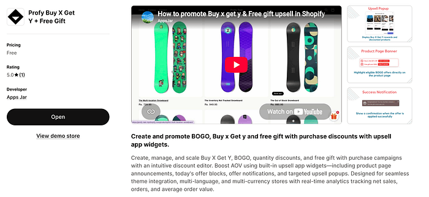
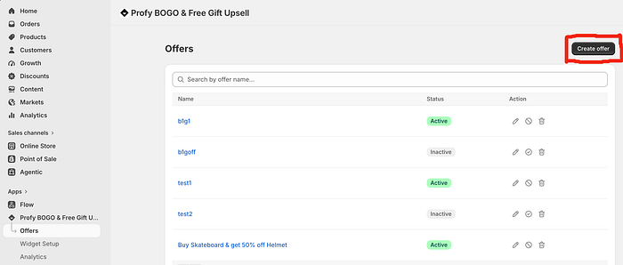
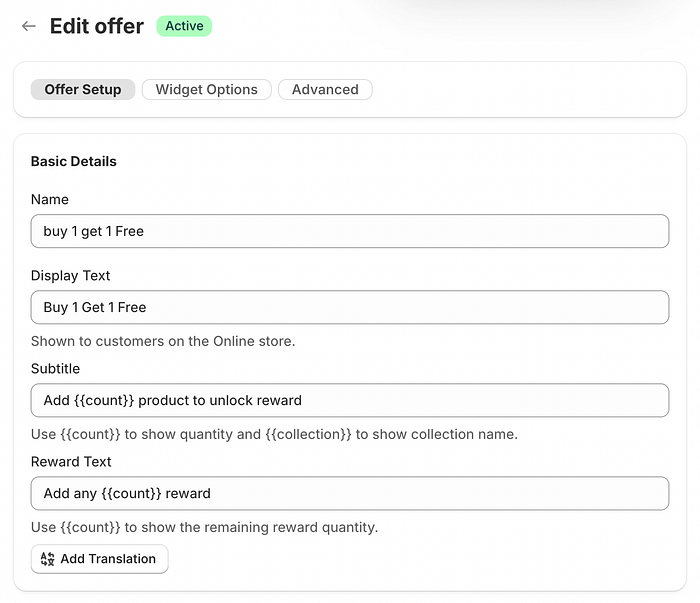
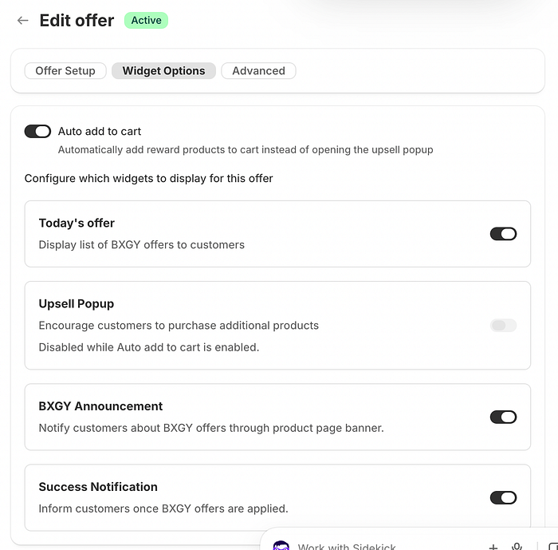
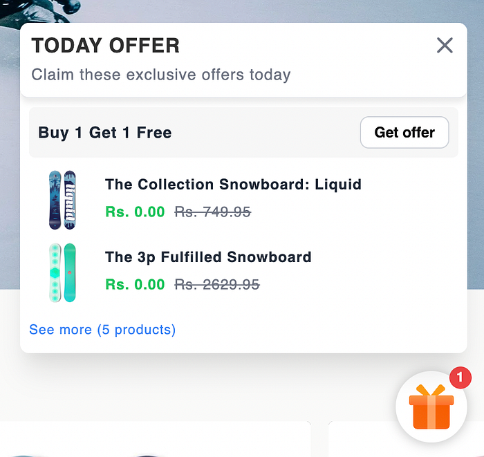
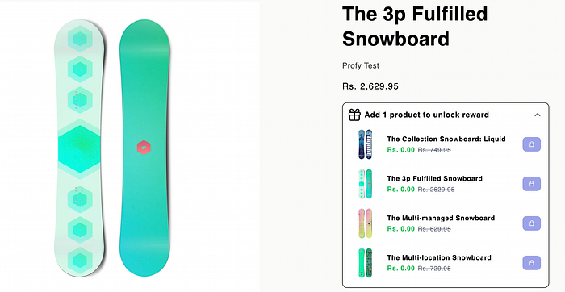
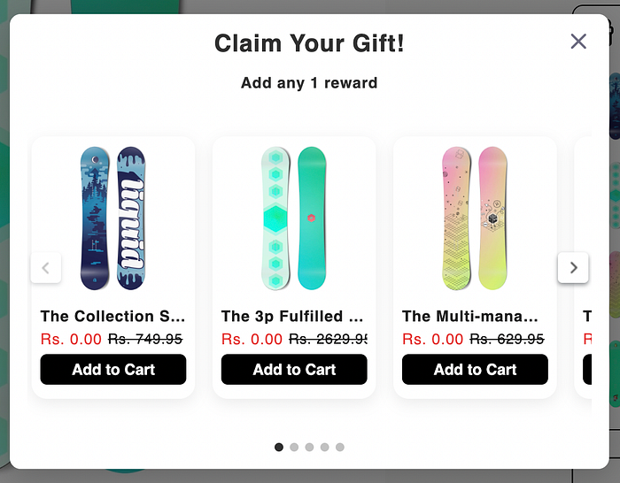
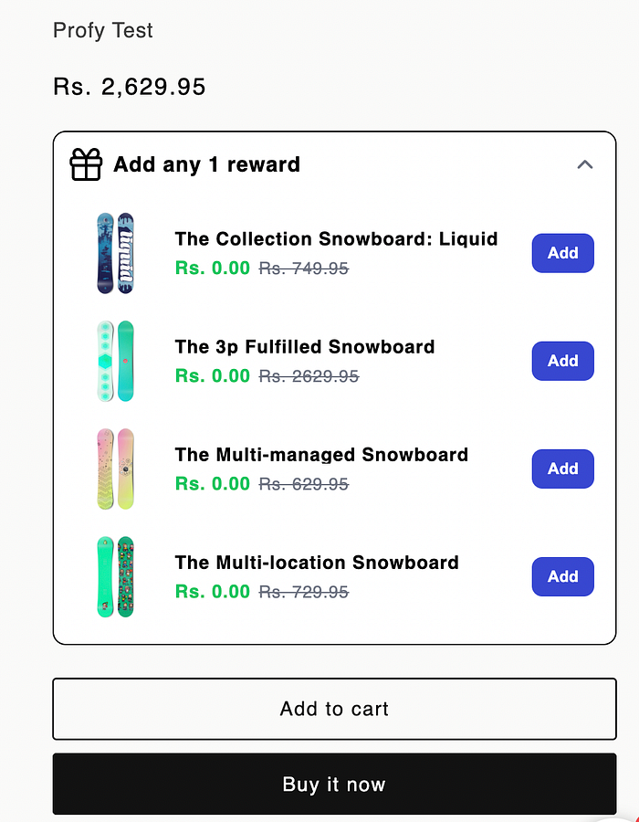
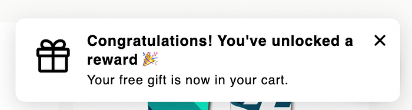

**Buy 1 Get 1 Free** is one of the simplest types of Buy X Get Y promotions. Customers receive a free product as a reward when they purchase a qualifying item. The free gift can be either the same product or a different product of your choice.

Unlike quantity-based offers such as Buy 2 Get 1 Free, this promotion is **easier for customers to understand and redeem**, as they only need to purchase one qualifying item to unlock their free gift.

You can also explore our related articles to learn how to create \[Buy 2 Get 2 Free offers\] or \[automatically add free gifts to Shopify orders\].

In this article, we’ll walk through how to create a **Buy a Skateboard Get a Helmet Free** discount and use promotional widgets to inform customers about the offer and help them easily claim their free gift.

### Limitations of Offering “Buy 1, Get 1 Free” Natively in Shopify

Creating a **Buy 1 Get 1 Free** discount in Shopify is straightforward and follows the same process as creating other Buy X Get Y discounts. You can refer to [Shopify’s official guide](https://help.shopify.com/en/manual/discounts/discount-types/buy-x-get-y) for step-by-step instructions.

However, running a Buy 1 Get 1 Free campaign using Shopify’s default functionality comes with several limitations:

1. **No offer promotion:** Shopify doesn’t provide built-in tools to inform customers that a Buy 1 Get 1 Free offer is active while browsing your store.
2. **Manual gift addition:** Even after customers purchase the qualifying product, they must manually find and add the free gift to their cart, making the offer less convenient to redeem.
3. **Limited offer visibility:** Customers aren’t clearly informed about which products are eligible for the promotion or which free gifts they can claim.
4. **No immediate confirmation:** Customers aren’t notified when the offer is successfully applied. They may only discover the discount when they reach the checkout page.

These limitations make it **harder for customers to discover and redeem** your Buy 1 Get 1 Free offer, potentially reducing participation and the overall effectiveness of your campaign.

### Installing a Shopify App for “Buy 1, Get 1 Free” Offers

<figure>
  
  <figcaption>Profy app page</figcaption>
</figure>

To overcome the limitations of Shopify’s default discount functionality, we’ll install the [**Buy X Get Y + Auto Add Free Gift**](https://apps.shopify.com/profy-bogo-free-gift-upsell) Shopify app.

**Link**: [https://apps.shopify.com/profy-bogo-free-gift-upsell](https://apps.shopify.com/profy-bogo-free-gift-upsell)

The app supports not only Buy 1 Get 1 Free promotions but also other types of **Buy X Get Y offers, such as Buy 2 Get 1 Free, Buy 1 Get 20% Off**, and other product-based and quantity-based discounts.

The app provides promotional widgets that **inform customers about active Buy 1 Get 1 Free offers** even before they add any products to their cart. Once customers add the qualifying product and satisfy the Buy condition, the **widgets prompt them to select and add their free gift**. Alternatively, the gift can be automatically added to the cart.

This makes it easier for customers to **discover the promotion, understand how to qualify, and redeem their free gift**, helping you get more value from your Buy 1 Get 1 Free campaign.

### Creating a “Buy One, Get One Free” Offer

Navigate to the **Offers** page and click the **Create Offer** button to start setting up a new Buy 1 Get 1 Free discount.

<figure>
  
  <figcaption>Create offer button</figcaption>
</figure>

Under the **Offer Setup** section, enter a unique offer name for internal reference and add the **Display Text**, which will be shown to customers in the promotional widgets.

Use the **Subtitle** to explain the Buy 1 purchase requirement. Once customers satisfy this condition, the **Reward Text** is displayed to prompt them to select and add their free gift to the cart.

<figure>
  
  <figcaption>Offer setup section</figcaption>
</figure>

### Enabling the Auto Add to Cart Option

By default, the **Upsell Popup** is displayed to let customers choose their preferred free gift once they satisfy the Buy 1 condition.

Alternatively, you can enable the **Auto Add to Cart** feature to automatically add the free gift to the cart without displaying the popup or requiring customers to select it manually.

<figure>
  
  <figcaption>Enabling auto add to cart option</figcaption>
</figure>

### Informing Customers About the “Buy 1, Get 1 Free” Offer Before They Buy

It’s important to promote your Buy 1 Get 1 Free offer **early in the customer’s shopping journey**.

Highlighting the offer while customers are browsing can grab their attention, encourage them to explore the promotion, and **motivate them to make a purchase they might not otherwise have considered**.

<figure>
  
  <figcaption>Today’s offer widget</figcaption>
</figure>

The product announcement widget provides customers with details of the Buy 1 Get 1 Free offer, along with a **list of available free gift options**. It also displays the **original and discounted prices**, helping customers understand the value of the promotion before making a purchase.

<figure>
  
  <figcaption>Offer announcement widget</figcaption>
</figure>

### Prompting Customers to Select the Free Gift

Once the Buy 1 condition is satisfied, the **Upsell Popup** is displayed, prompting customers to select their preferred free gift.

Alternatively, if **Auto Add to Cart** is enabled, the free gift is automatically added to the cart without displaying the popup or requiring customers to select it manually.

<figure>
  
  <figcaption>Upsell popup</figcaption>
</figure>

The product announcement widget also allows customers to select their free gift once the **Buy 1 condition is satisfied**. This gives customers the flexibility to claim their free gift either through the Upsell Popup or directly from the product announcement widget.

<figure>
  
  <figcaption>Announcement widget with rewards unlocked</figcaption>
</figure>

### Notifying Customers When the “Buy 1, Get 1 Free” Offer Is Applied Successfully

Once the free gift is added to the cart and the Buy 1 Get 1 Free discount is successfully applied, a **success notification is displayed** to confirm that the offer has been applied to order.

<figure>
  
  <figcaption>Offer success notification</figcaption>
</figure>

### Final Result and Demo

The final result is a fully promoted Buy 1 Get 1 Free offer that customers can discover through the **Today’s Offer** and **Product Announcement** widgets while browsing your store.

Once the customer satisfies the Buy 1 condition, the **Upsell Popup** is displayed, prompting them to select their preferred free gift. Alternatively, if **Auto Add to Cart** is enabled, the free gift is automatically added to the cart without displaying the popup.

Finally, once the free gift is added and the Buy 1 Get 1 Free discount is successfully applied to the order, a **Success Notification** is displayed to confirm that the offer has been activated.

<figure>
  <iframe width="100%" height="415" src="https://www.youtube.com/embed/0yHBv3IDRt8?si=xK5CFOswA9AGw2Z5&t=153s" title="Buy X Get Y app widgets demo" frameborder="0" loading="lazy" fetchpriority="low"
    allow="accelerometer; autoplay; clipboard-write; encrypted-media; gyroscope; picture-in-picture; web-share"
    referrerpolicy="strict-origin-when-cross-origin" allowfullscreen></iframe>
  <figcaption>Buy 1 get 1 free demo</figcaption>
</figure>
