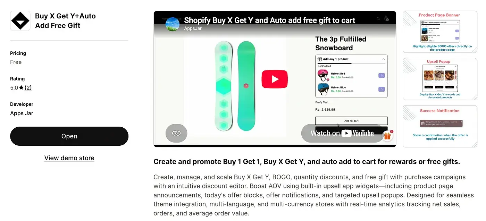
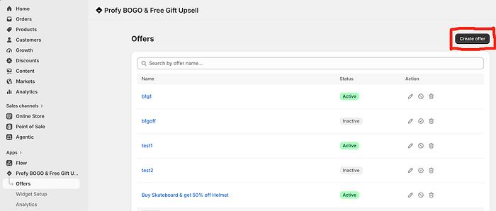
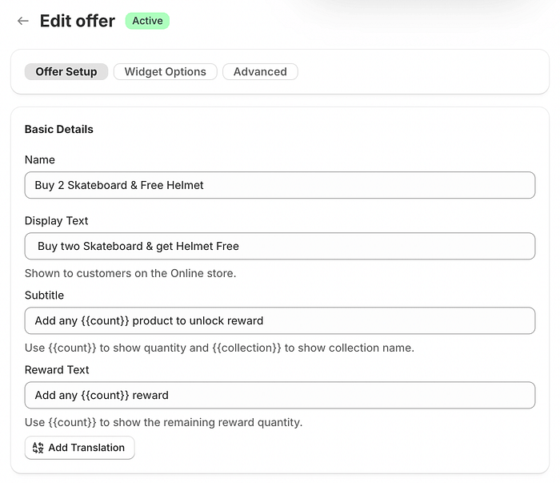
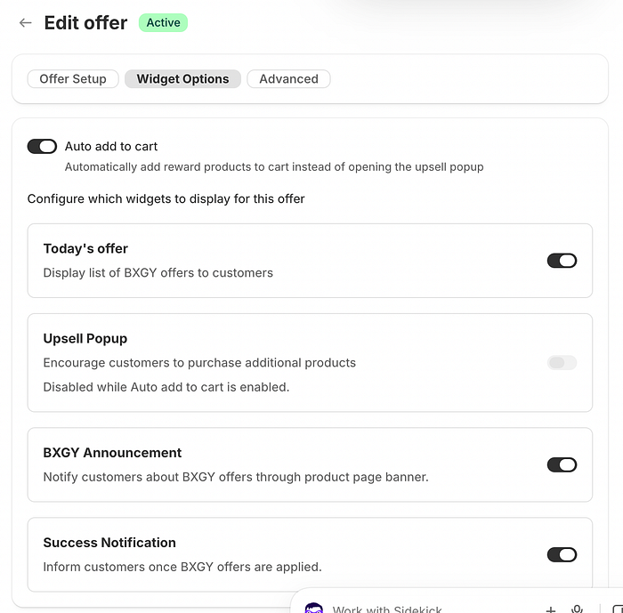
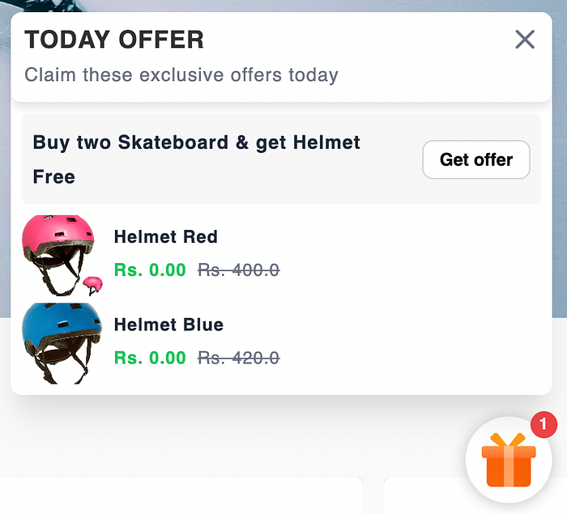
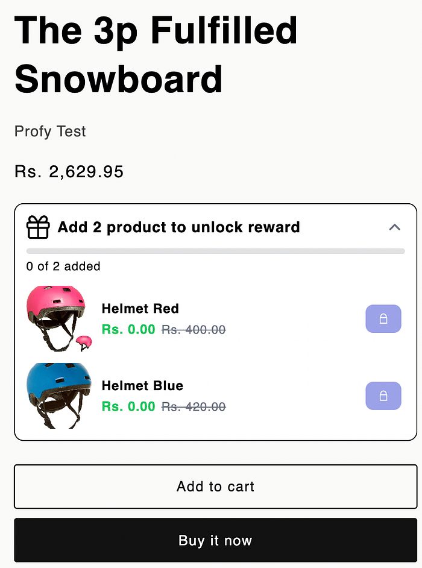
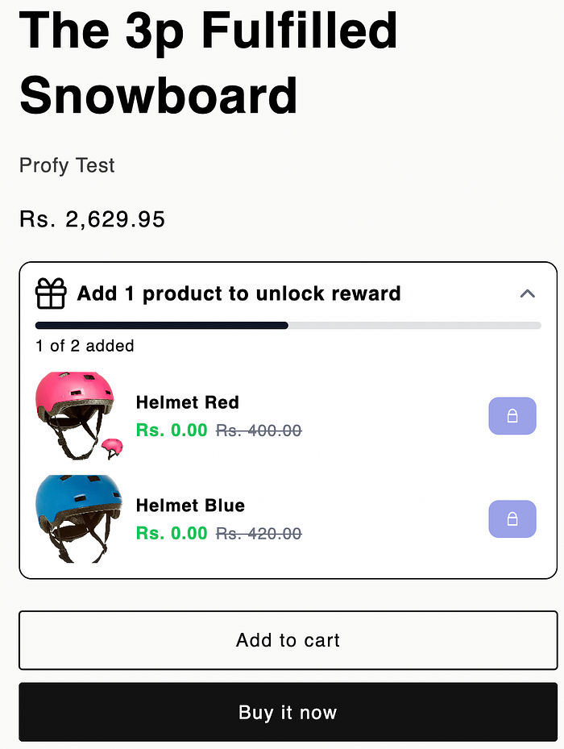
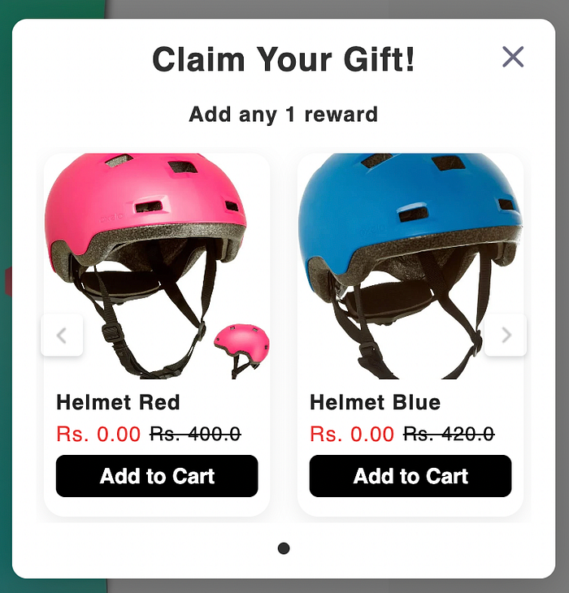
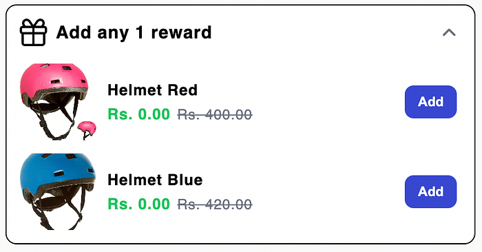
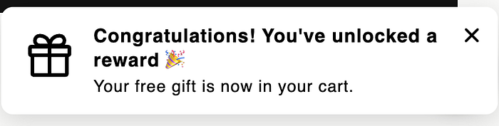

A **Buy 2 Get 1 Free** offer is a great way to encourage bulk purchases by rewarding customers with a free product when they buy two items. This helps **increase the number of items per order and improve your store’s average order value (AOV)**.

The free gift can be either the same product (e.g., Buy 2 Skateboards Get 1 Skateboard Free) or a different product of your choice.

You can also explore our related articles to learn how to create [Buy 1 Get 1 Free offers](https://appsjar.net/blog/buy-one-get-one-free-shopify/) or [automatically add free gifts to Shopify orders](https://appsjar.net/blog/automatically-add-free-gift-purchase-shopify/).

In this article, we’ll walk through how to create a **Buy 2 Skateboards Get 1 Skateboard Free** offer, promote it to customers, and track its performance.

### Limitations of Managing “Buy 2, Get 1 Free” Natively in Shopify

You can create buy two get one free like how u create other standary Buy X get Y free discount through Shopify discount section following this guide [https://help.shopify.com/en/manual/discounts/discount-types/buy-x-get-y](https://help.shopify.com/en/manual/discounts/discount-types/buy-x-get-y) .

However the options are very limited like:

1. **Customers are not informed before adding to cart** that if the offer is active.

2. **Which items are eligible for the offer** and on purchase of which 2 items the buy condition will be satisfied.

3. **The free gift needs to be manually added to cart** which makes it difficult to avail and also customers are not informed which Item or list of items that are offered as free gift.

4. Once the offer is applied successfully the **customers are not informed until the visit the cart page**.

### Installing a Shopify App for “Buy 2, Get 1 Free” Offers

<figure>
  
  <figcaption>Profy app page</figcaption>
</figure>

To overcome these limitations and make your **Buy 2 Get 1 Free** promotion easier for customers to discover and redeem, we’ll use the [**Profy Buy X Get Y+Buy 1 Get 1**](https://apps.shopify.com/profy-bogo-free-gift-upsell) Shopify app.

**Link**: [https://apps.shopify.com/profy-bogo-free-gift-upsell](https://apps.shopify.com/profy-bogo-free-gift-upsell)

The app supports various types of Buy X Get Y promotions, including Buy 1 Get 1 Free, Buy 2 Get 1 Free, Buy 2 Get 50% Off, and other product-based or quantity-based offers.

The app provides **four promotional widgets** that work together throughout the customer’s shopping journey:

- **Promote the offer:** Inform customers about available Buy 2 Get 1 Free promotions while they browse your store.
- **Show eligible products:** Display offer details and available free gift options on applicable product pages.
- **Encourage gift redemption:** Once customers purchase the required two products, prompt them to select and add their free gift. Alternatively, automatically add the gift to their cart.
- **Confirm successful redemption:** Display a success notification once the free gift is added and the discount is successfully applied.

### Creating a “Buy 2, Get 1 Free” Offer

Navigate to the **Offers** page and click the **Create Offer** button to start creating a new Buy 2 Get 1 Free discount.

<figure>
  
  <figcaption>Create offer button</figcaption>
</figure>

Under **Basic Details**, enter the information for your Buy 2 Get 1 Free offer. Provide an offer name for internal reference and display text that will appear in the promotional widgets shown to customers.

Use the **Subtitle** to explain the Buy 2 purchase requirement. Once customers satisfy this condition, the **Reward Text** is displayed to encourage them to select and add their free gift to the cart.

<figure>
  
  <figcaption>Offer setup section</figcaption>
</figure>

### Enabling the Auto-Add to Cart Feature

You can choose between two ways to deliver the free gift. Enable the **Upsell Popup** to let customers choose their preferred free gift from the available options, or enable **Auto Add to Cart** to automatically add the free gift once the Buy 2 purchase condition is satisfied.

<figure>
  
  <figcaption>Enabling auto add to cart option</figcaption>
</figure>

### Highlighting “Buy 2, Get 1 Free” Offers Before Cart Addition

The **Today’s Offer widget** informs customers about the available Buy 2 Get 1 Free promotion and provides a direct link to the collection containing eligible products, making it easy for customers to explore the offer and start shopping.

<figure>
  
  <figcaption>Today’s offer widget</figcaption>
</figure>

When a customer visits a product page where the Buy 2 Get 1 Free offer is applicable, the **Offer Announcement widget** displays the promotion details, including the purchase requirements, a **progress bar showing how close the customer is to qualifying** for the offer, and a list of available reward products with their discounted prices. This helps customers understand **how to unlock the free gift** and encourages them to **add more eligible products** to their cart.

<figure>
  
  <figcaption>Product page announcement widget</figcaption>
</figure>

The progress bar **updates dynamically as customers add eligible products** to their cart, displaying the current progress towards meeting the Buy 2 requirement. This helps customers **track how close they are to unlocking their free gift** and encourages them to add the remaining items to qualify for the offer.

<figure>
  
  <figcaption>Announcement widget with 1 item added</figcaption>
</figure>

### Prompting Customers to Select the Free Gift

Once the Buy 2 purchase condition is satisfied, the **Upsell Popup** is displayed, prompting customers to select their preferred free gift from the available reward options.

Alternatively, if **Auto Add to Cart** is enabled, the free gift is automatically added to the cart without displaying the popup or requiring customers to select it manually.

<figure>
  
  <figcaption>Upsell popup</figcaption>
</figure>

Once the Buy 2 condition is satisfied, the **Offer Announcement widget** also updates to display the reward text, encouraging customers to select and add their free gift to the cart. This works alongside the Upsell Popup, providing customers with an **additional way to claim their reward**.

<figure>
  
  <figcaption>Announcement widget with rewards unlocked</figcaption>
</figure>

### Notifying Customers When the “Buy 2, Get 1 Free” Offer Is Applied Successfully

Once the free gift is added and the Buy 2 Get 1 Free discount is successfully applied, a **success notification** is displayed to **confirm that the offer has been applied**. This keeps customers informed without requiring them to visit the cart page to verify whether the discount has been applied.

<figure>
  
  <figcaption>Offer success notification</figcaption>
</figure>

### Final Result and Demo

The final result is a fully promoted **Buy 2 Get 1 Free** offer displayed across your Shopify store using different promotional widgets. **Customers can discover the offer through announcement widgets, track their progress with a dynamic progress bar**, and are prompted to claim their free gift once the purchase conditions are met.

This makes the offer easier to understand and redeem, encouraging customers to purchase more products and helping increase your store’s average order value (AOV).

<figure>
  <iframe width="100%" height="415" src="https://www.youtube.com/embed/Odt7DhMbOSw?si=V7QiNGCxR0lC3ykb&start=15" title="Buy X Get Y app widgets demo" frameborder="0" loading="lazy" fetchpriority="low"
    allow="accelerometer; autoplay; clipboard-write; encrypted-media; gyroscope; picture-in-picture; web-share"
    referrerpolicy="strict-origin-when-cross-origin" allowfullscreen></iframe>
  <figcaption>Buy 2 get 1 free demo</figcaption>
</figure>
