## Why Do You Need a Countdown Timer for Your Shopify Store?

1. **Create a Sense of Urgency**: Encourage customers to make quicker purchase decisions by displaying countdown timers alongside discounts and special offers.
2. **Increase Customer Engagement**: Capture customers’ attention with visually appealing countdown timers and encourage quicker purchase decisions.
3. **Promote Flash Sales and Seasonal Offers:** Create time-limited promotions for festivals and special occasions, such as Black Friday, Christmas, and holiday sales.

### Types of Countdown timers

1. **Sale Countdown Timer**: Create countdown timers with specific start and end dates to promote festival and seasonal discounts, such as Halloween, Black Friday, and Christmas sales.
2. **Weekly Recurring Sales**: Set up recurring countdown timers for specific days of the week to promote regular discounts. For example, run a “ **Tenner Tuesday**” campaign where selected products are discounted every Tuesday.
3. **Shipping Deadline Timer**: Display a daily recurring countdown timer to highlight order and shipping deadlines, such as “ **Order within 4 hrs 12 mins for dispatch today.**” This creates urgency and encourages customers to complete their purchases sooner.

### 1) Install “Profy Banner & Countdown Timer” Shopify plugin

<figure>
  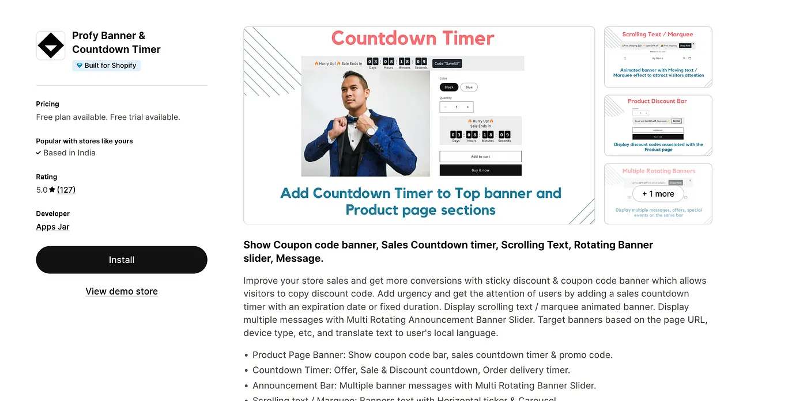
  <figcaption>Profy app page</figcaption>
</figure>

Link: [https://apps.shopify.com/profy-promo-bar](https://web.archive.org/web/20250210230936/https://apps.shopify.com/profy-promo-bar?ref=contact)

The **Profy Banner & Countdown Timer** Shopify app makes it easy to create customizable countdown timer banners and popups for your store. With multiple styling and scheduling options, you can set up engaging countdown timers **without any coding knowledge**.

### 2) Enable App embed

After installing the app, enable the **App Embed** from your Shopify theme editor to ensure the countdown timer displays correctly on your storefront.

<figure>
  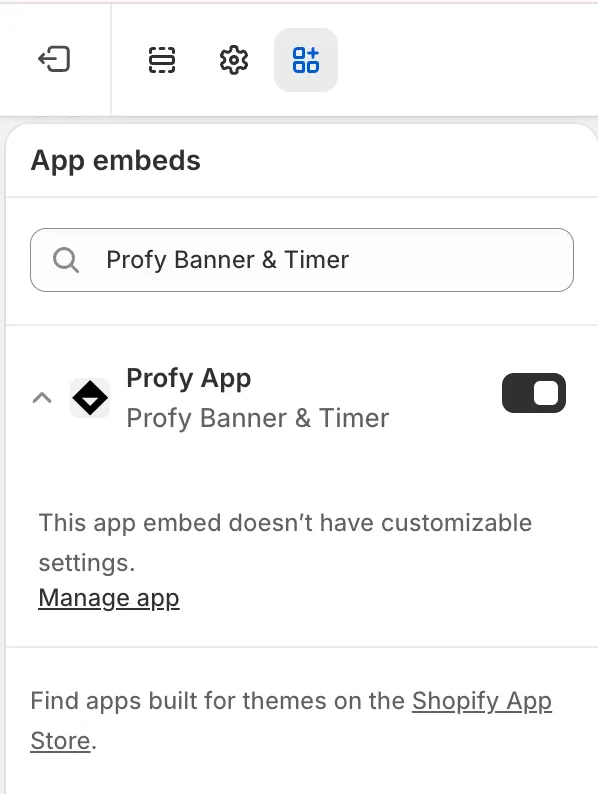
  <figcaption>App embed</figcaption>
</figure>

### 3) Click on Create Banner and Select “Countdown timer”

To create your first banner, navigate to the app’s **Home page** and click the “ **Create Banner”** button.

<figure>
  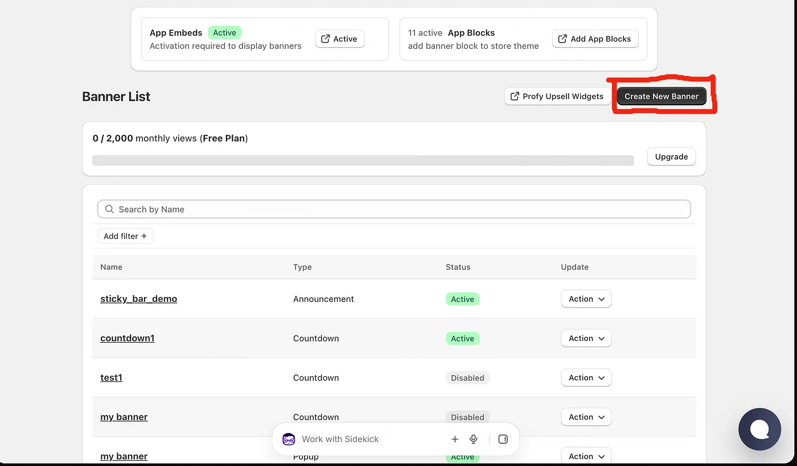
  <figcaption>Click on Create New Banner</figcaption>
</figure>

As the first step, choose where you want your banner to appear. You can select from **Top/Bottom Bar**, **Product Page**, **Inside Page Section**, or **Popup**.

<figure>
  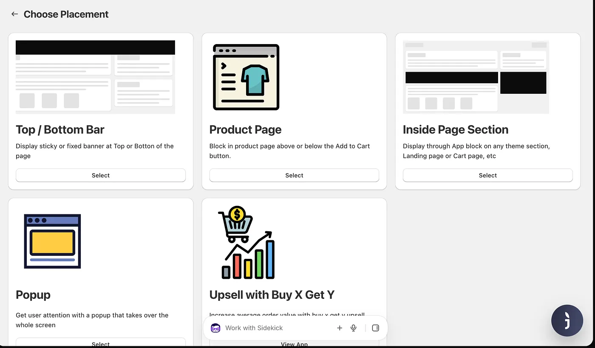
  <figcaption>Placement Options</figcaption>
</figure>

In the second step, select **Countdown Timer** as the banner type to create a countdown timer for your Shopify store.

<figure>
  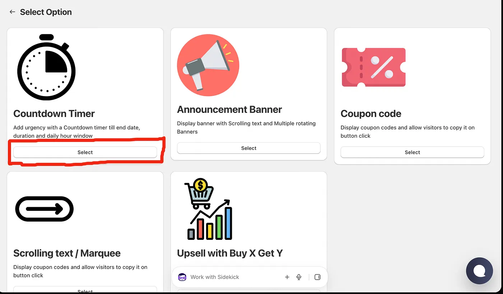
  <figcaption>Select Countdown timer option</figcaption>
</figure>

For the countdown type, you can choose from three options based on your promotional requirements:

1. **Till End Date**: Ideal for sale countdowns with specific start and end dates, such as Black Friday or seasonal sales.
2. **Recurring Countdown**: Perfect for weekly recurring promotions, where the countdown resets on selected days, such as Tuesday or weekend sales.
3. **Time Window**: Best suited for shipping deadline timers that reset daily, such as “ **Order within 4 hours for dispatch today.**”

<figure>
  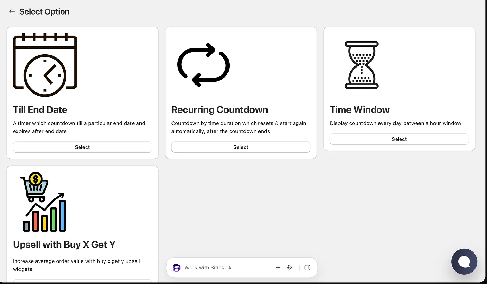
  <figcaption>Types of countdowns</figcaption>
</figure>

### Sale Countdown: Till End Date

With this option, the timer **counts down to the end date** specified by the user. For example, if you’re running a festival sale with 20% off that ends in five days, simply set the end date to five days from now.

The countdown timer displays the **remaining time until the sale ends**. Once the current date and time pass the configured end date, the **timer expires and is automatically hidden** from your storefront.

<figure>
  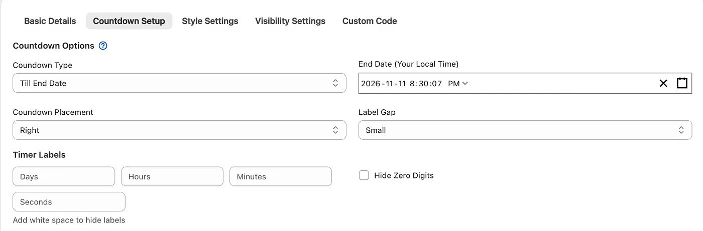
  <figcaption>Sale countdown till end date</figcaption>
</figure>

To create an end-date-based countdown, navigate to the **Countdown Setup** tab and select **Till End Date** as the countdown type. Set your desired end date and save the banner to activate the countdown timer.

### Weekly Recurring day-based sale: Time Duration

This option lets you create an **evergreen countdown timer** that counts down from a specified duration and **automatically resets** when the countdown reaches zero.

<figure>
  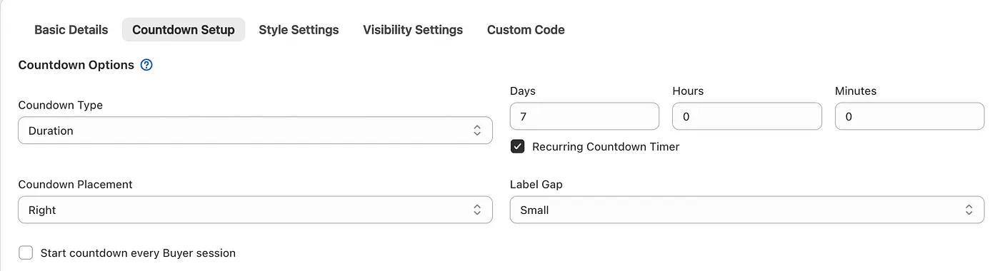
  <figcaption>Weekly recurring countdown</figcaption>
</figure>

For example, suppose you want to offer discounts on selected products **every Tuesday and automatically repeat the promotion each week** without having to configure it again.

To achieve this, set the **Duration to 7 days** and the **Start Date to 12:00 AM on the previous Tuesday**. The countdown will run for seven days and automatically reset every Tuesday.

You can also restrict the countdown timer to display only on Tuesdays by adding the following code under **Custom Code → Custom JavaScript**:

```
// Function to check the UTC day and hide/show the banner form
function checkAndHideBannerForm() {
    const widgetId = "your-widget-id-here"; // Replace with your actual widget ID if dynamic
    const bannerForm = document.querySelector(`.profy-${widgetId}-banner-form`);

    if (!bannerForm) return; // Exit if the element doesn't exist on the page

    // getUTCDay() returns 0 for Sunday, 1 for Monday, 2 for Tuesday, etc.
    const currentUTCDay = new Date().getUTCDay();

    // If it is NOT Tuesday (2), hide the banner form
    if (currentUTCDay !== 2) {
        bannerForm.style.display = "none";
    } else {
        bannerForm.style.display = ""; // Reset or show if it is Tuesday
    }
}

checkAndHideBannerForm()
```

### **Shipping deadline timer: Specific hours of a day**

This option lets you display a countdown timer within a **specified time window each day**. The timer automatically resets daily, making it ideal for recurring promotions and shipping deadline notifications.

<figure>
  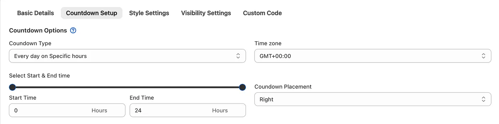
  <figcaption>Time window countdown</figcaption>
</figure>

For example, suppose you want to display a shipping deadline timer that promises **next-day delivery for orders placed before 2 PM**.

Set the **Time Window** between 12:00 AM (0 hours) and 2:00 PM (14 hours). Add a countdown message such as “ **Products will be delivered by tomorrow.**”

The timer will count down to 2 PM and automatically disappear once the deadline passes. It will then reset and appear again at midnight the following day, ready for the next day’s orders.

### 4) **Enter banner content**

<figure>
  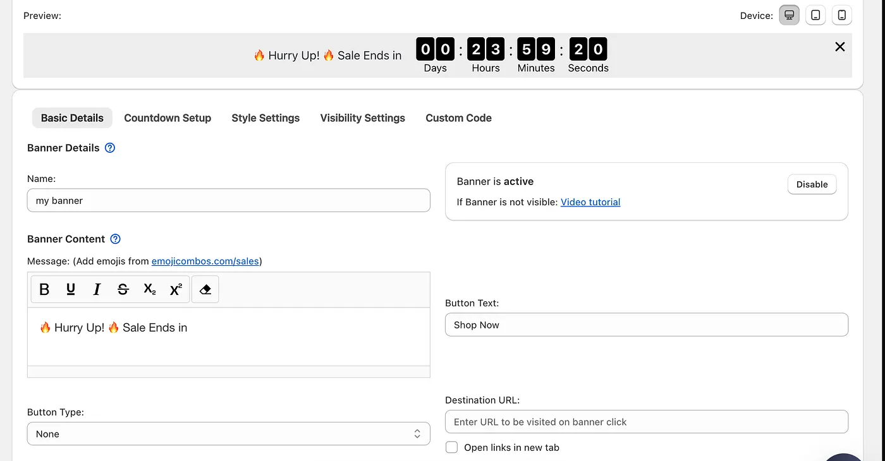
  <figcaption>Basic details section</figcaption>
</figure>

Based on your requirements, enter the appropriate **banner message and button text**, and configure the **destination URL** where customers should be redirected when they click the button.

### 5) Choose which pages to display on

<figure>
  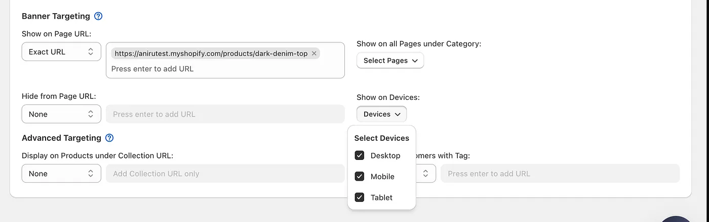
  <figcaption>Banner targeting options</figcaption>
</figure>

By default, the **banner is displayed across all pages** of your Shopify store. However, you can customize the banner targeting to display it only on selected pages.

### **6) Customize countdown timer design base on your Store theme**

<figure>
  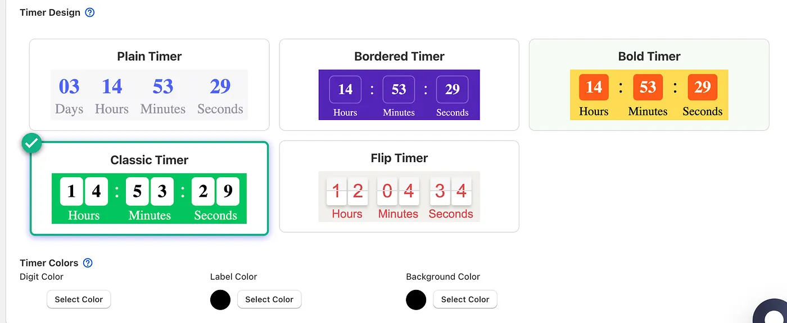
  <figcaption>Timer Settings</figcaption>
</figure>

Choose from **five unique countdown timer designs** and customize the **label, digit, and background colors** to match your store’s branding and style.

### 7) Configure banner visibility

In the **Visibility Settings** tab, you can configure the banner’s display position (top or bottom), enable the sticky banner option, and set its start and end dates. You can also customize additional visibility settings to control when and where the banner appears on your storefront.

<figure>
  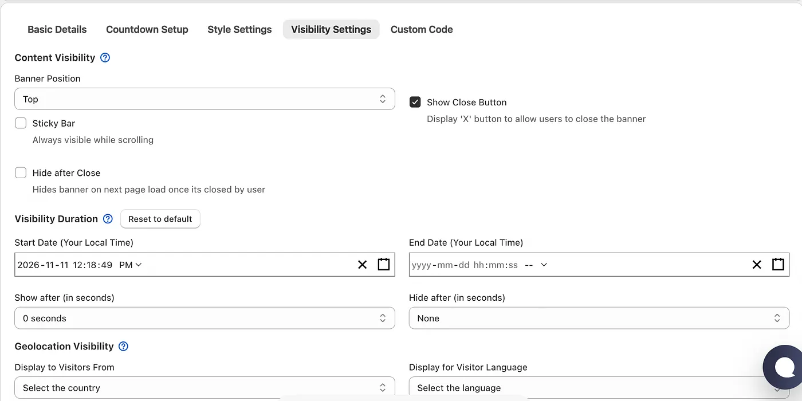
  <figcaption>Visibility settings</figcaption>
</figure>

### 8) Final result

Once saved, the countdown timer banner will appear in your selected placement on the storefront, displaying the timer according to the countdown settings configured during banner setup.

<figure>
  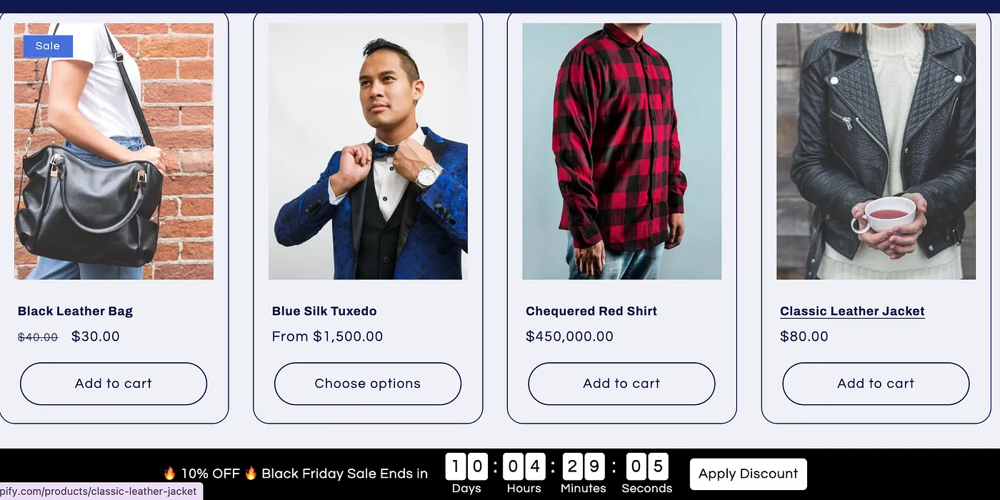
  <figcaption>Final result</figcaption>
</figure>
